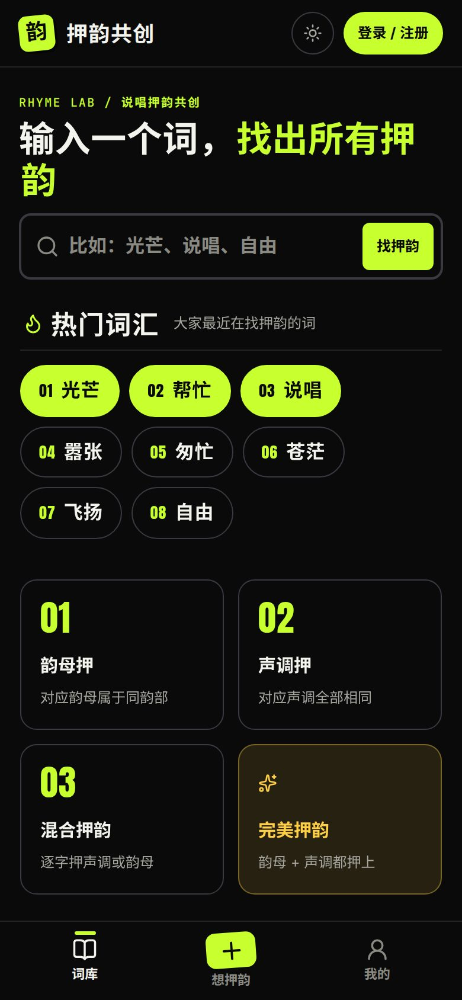
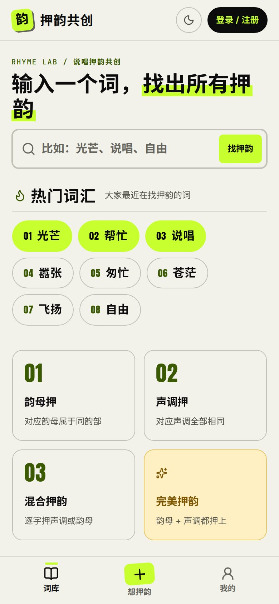
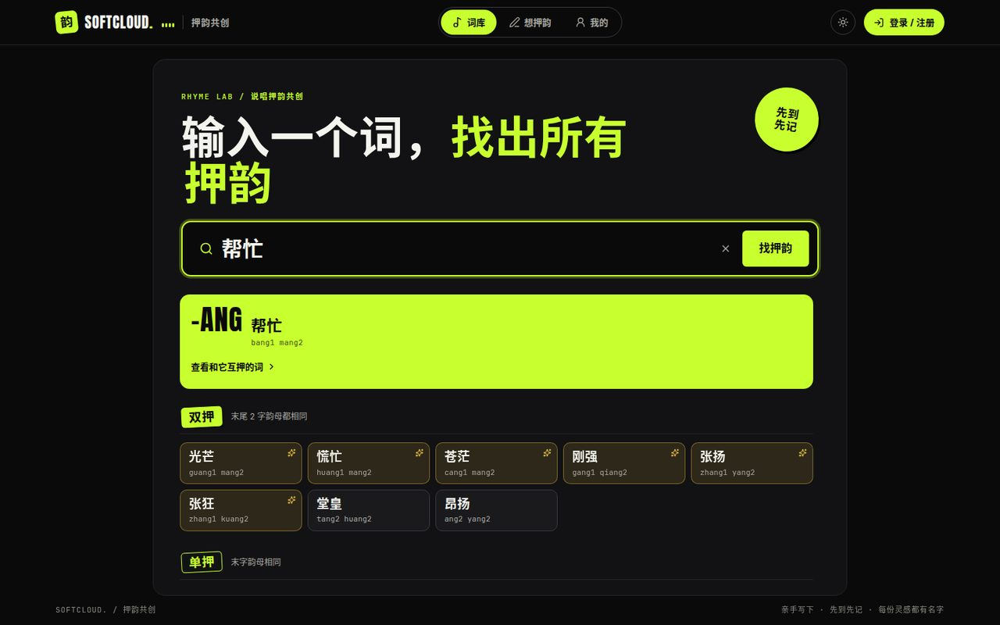
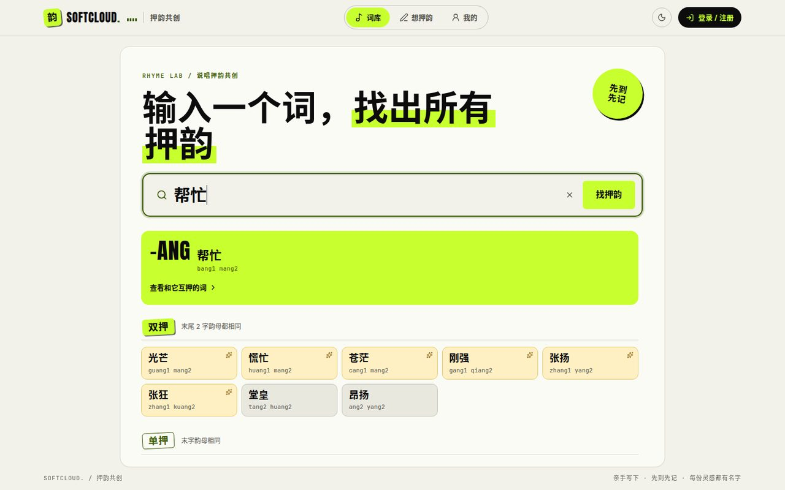
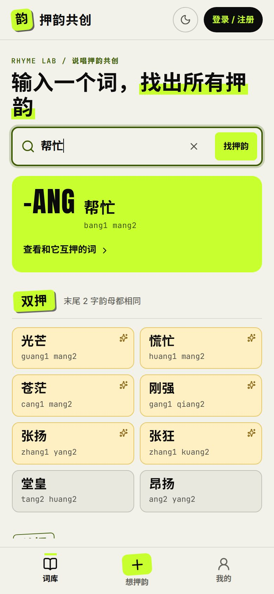

# 押韵共创

说唱押韵共创社区：用户写下互相押韵的词，服务器按普通话韵部与声调逐字核验，记录每组关系的最先提交者。正式内容全部来自用户，不导入押韵库或测试种子。

技术栈为 React、TypeScript、Vite、Hono、Cloudflare Workers Static Assets 与 D1。颜色、字号、间距与动效使用 `--sc-*` 令牌。

| 环境 | 地址 | 说明 |
| --- | --- | --- |
| 正式 | https://ya.zoci.pro | Worker `rhyme-community-ya`，Workers Builds 从 `main` 自动部署，绑定生产 D1 `352be9ba-ecc6-4240-b5d8-277741a449bd` |

完整源码：[zocipro/rhyme-community](https://github.com/zocipro/rhyme-community)。上线门槛见 `READINESS.md`，已验证结果见 `VERIFICATION.md`，资源 ID 见 `deployment.json` 与 `wrangler.jsonc`。

## 截图

本地 `wrangler dev` + 本地 D1 测试数据，酸绿 Cypher 配色。深色为默认，浅色由页头切换。

### 词库首页（搜索框 + 热门词汇）





### 搜索结果（按单押 / 双押 / 三押分区）






### 对等互查


### 我的


## 词库：搜索押韵

首页（词库）是一个押韵搜索框。输入任意词，用项目既有的韵部与声调规则比对全部已收录词，结果按末尾连续押上韵母的字数分区：单押、双押、三押、四押…（数据支持几押就显示几押，多押在前）；只押声调的合法押韵列在最后。查询词本身单独标出，不混入分区。

搜索框下方为「热门词汇」，按被搜索次数排序。只统计已确认的搜索（提交、点击热门词，或结果稳定约 1.5 秒），不计每个按键；规范化后须为 2–12 个汉字。同一来源每天每词只计一次、每天最多 40 个不同词，并受统一写入限流；至少两个来源搜过才上榜。界面只展示词，不展示次数。

词语界面不显示「已收录 N 对」等计数。点开一词进入对等互查：这些词彼此押韵，间接相连者标为「同组词」，并列出实际收录的关系（A ↔ B、种类、最先提交者与时间、逐字对照）。

## 想押韵：投稿与计分

主投稿入口是「想押韵 / 我来想一个押韵」，不再有先出题、再答题的流程。一次填写 2–50 个词，每词至少两个汉字。词可复用于新的组合；规范化后的无向词对全站唯一，正反顺序和不同读音不会产生第二个名额。

所有词必须两两押韵。每对按较短词的汉字数 N 对齐双方末尾；每个位置的韵部或声调至少匹配一项，可混合。普通有效押韵 N 分，韵部与声调全部相同为完美押韵 2N 分。每个新词对单独计分，预览显示逐对结果和合计。任一词对无效、已收录或已撤回，整批不保存、不计分，保留输入和读音选择。

服务器重算分数并在同一事务中保存；`requestId` 使网络重试返回原结果而不重复加分。首次归属只属于真实词对，永远保留最早成功保存者与时间。词本身不归属于「出题者」；同组间接成员也不获得虚构的首创记录。

## 读音与判定

保留原文。规范化统一全半角并忽略标点、空白和默认不可见字符。单次请求最多 2 MiB；全部词合计最多 10,000 个汉字，全部词对按较短词累计的比较位置最多 20,000。超出预算在解析读音前拒绝，输入仍保留。

使用普通话字典读音，不自动变调。多音字可选择合法读音，每个词在一个批次中使用同一套选择，选定读音随词对保存。成音节鼻音保留 `m/n/ng`，空韵母不会产生匹配。

韵母按明确韵部比较，允许介音不同：`a/ia/ua`、`o/uo`、`ai/uai`、`ei/uei`、`ao/iao`、`ou/iou`、`an/ian/uan/üan`、`en/uen/ün`、`ang/iang/uang`、`eng/ueng`、`ong/iong`、`ie/üe`；其他韵母按自身匹配。逐字对照保留完整韵母和声调：匹配为蓝色、不匹配为红色、完美为金色，均有文字标签。

词库互查基于有效关系的连通组。直接投稿过的词对展示首次作者、时间和读音对照；间接成员标为「同组词」，展示支撑它入组的实际关系。撤回后按剩余有效关系重新分组。

## 界面、账号与管理

手机底部导航为独立的「词库 / 想押韵 / 我的」；长内容各自滚动，主要按钮保持可见。桌面词库为居中搜索；打开一词后左侧结果、右侧互查。投稿页用「填写词语 / 逐对核验」切换。可匿名预览，登录后提交；登录、换页与同一标签页刷新保留草稿（sessionStorage）。成功保存的内容和积分由 D1 跨设备同步。

视觉为第三轮「Cypher」说唱海报风：默认深色（近黑底 `#0a0a0b` + 荧光酸绿 `#c8ff2e`），浅色为纸色底 + 加深的酸绿文字。页头切换并保存在本机。标题与数字使用本地打包的 Anton（仅拉丁字形），中文回退系统粗黑体；拼音、编号使用等宽字体。贴纸徽章、划重点、跑马灯与 EQ 节拍微动效用 `--sc-beat`（约 96 BPM），在「减少动态效果」下全部停止。不加载外部字体或 CDN。

用户名/密码注册登录，独立随机盐和 scrypt 哈希，Cookie 为 HttpOnly/SameSite=Lax，线上为 Secure。服务器检查来源、限流和管理权限。管理员通过一次性私有初始化建立，普通注册不能成为管理员。

「我的」展示本人押韵关系、累计积分和积分来源。管理员可撤回一条关系、处理普通账号和查看审计；撤回保留原文、首次归属与唯一键，扣回相关积分，并按剩余有效关系更新分组。

输入法组合期间只显示临时文字，确认时提交一次，取消不重置已选读音。读音字典进入投稿页时才加载。核验每次展示 40 个词对，可继续加载；全部词对仍照常校验和计分。查重未完成不能收录。

## 主要接口

列表每页 30 条。服务器不接受客户端指定分数。旧出题/答题写接口返回 410；旧只读接口仅内部归档兼容。

| 方法 | 路径 | 说明 |
| --- | --- | --- |
| GET | `/api/health` | 探活 |
| GET | `/api/me` | 当前会话与积分 |
| POST | `/api/auth/register` `/login` `/logout` | 注册、登录、退出 |
| GET / POST | `/api/setup` | 一次性管理员初始化 |
| POST | `/api/rhymes/preview` | `{items:[{text,readings?:string[]}]}` → 读音、逐对结果、重复归属、有效状态及总分 |
| POST | `/api/rhymes` | `{requestId,items}` → 批次、真实词对、新增积分、重放标志 |
| GET | `/api/rhymes/requests/:requestId` | 仅查当前账号原提交；写入暂停期间仍可确认 |
| GET | `/api/library/search?q=` | `{search:{query,error,exact,tiers}}`；`tier` 为末尾连续押上韵母的字数（0 为只押声调） |
| GET | `/api/search/hot` | `{items:[{text}]}`，至少两个来源搜过；表未建立时为 `[]` |
| POST | `/api/search/hits` | `{q}` → `{recorded}`；失败不阻断搜索 |
| GET | `/api/words` `/api/words/:id/rhymes` `/api/rhymes/:id` | 词与关系只读分页 |
| GET | `/api/profile` | 我的关系与积分来源 |
| GET | `/api/admin/records` | 管理记录 |
| POST | `/api/admin/withdraw` | `{type:'pair',id,reason}` |
| POST | `/api/admin/reset-password` | `{id,password}` |

API 请求读取正文有 20 秒超时。结果未确认的提交另存账号、词语、读音与 `requestId`，刷新后先查询原提交；确认旧提交不会清空后来编辑的新草稿。

## 数据迁移

| 文件 | 作用 |
| --- | --- |
| `0001_initial.sql` | 初始账号、旧 topics/answers、会话 |
| `0002_mixed_rhyme.sql` | 混合押韵标记 |
| `0003_direct_pairs.sql` | 增量：词、无向关系、批次、积分明细及旧 ID 映射；旧表保留归档 |
| `0004_search_counts.sql` | **只新建** `search_counts`、`search_hits`，不改不删已有表 |

`0003` 只把实际答案迁成原题与答案的关系，作者取原答案记录；不把原出题者转为押韵作者，不补造兄弟答案之间的关系。正反重复合并时最早归属不变。每位用户已有积分逐条保留。没有有效押韵的旧单独题目不进入新词库。

`0004` 与仍在运行的旧 Worker 兼容；表未建立时热门词汇为空、搜索不计数。`pnpm run build` 仅在 Workers Builds（`WORKERS_CI=1`）末尾执行 `wrangler d1 migrations apply DB --remote`；失败则构建失败、不部署。本地和测试不执行。`RHYME_SKIP_REMOTE_MIGRATIONS=1` 可关闭。手工补跑：`pnpm exec wrangler d1 migrations apply DB --remote`。

发布前：暂停内容写入（`content_write_paused=1`）→ 备份核对 → 迁移 → 发布 → 解除暂停。迁移末尾设置 `pair_model_ready=1`。不要把测试数据写入生产 D1。

## 开发与验证

需要 Node.js 22+ 与 pnpm，按 `pnpm-lock.yaml` 安装：

```sh
pnpm install --frozen-lockfile
cp .dev.vars.example .dev.vars   # 填入自己生成的 BOOTSTRAP_TOKEN
pnpm exec wrangler d1 migrations apply DB --local
pnpm test                        # 押韵规则
pnpm test:integration            # 数据库 / API
pnpm build                       # tsc + Vite；本地不跑远程迁移
pnpm worker                      # http://127.0.0.1:8787
```

开发初始化凭证禁止用于线上。新库执行 `pnpm bootstrap http://127.0.0.1:8787` 走一次性管理员初始化。

集成测试自行生成临时配置、空闲端口、本地 D1 和初始化凭证，不依赖项目 `.dev.vars`。覆盖历史迁移、整批回滚、并发、幂等、计分、权限、读音、整组互查、撤回、账号重置与事务故障回滚。

`node scripts/test-word-input.mjs /absolute/temporary/directory/node_modules/jsdom` 对 React 输入组件跑 6 项 IME 回归；官方 jsdom 只装在项目外临时目录，不改锁文件。

`verify-pairs-production-readonly.mjs` 与 `verify-maturity-production-readonly.mjs` 只读正式站 `ya.zoci.pro`。`audit-pair-migration.mjs production before|after` 核对历史字段和积分。仓库里仍留着已下线的 staging 校验脚本，不要再对它们执行写入。数据库备份与私人管理员入口放项目目录外，不进源码包。

## 部署

唯一正式环境是 Worker `rhyme-community-ya`、自定义域名 `ya.zoci.pro`，D1 为 `rhyme-community`（`352be9ba-ecc6-4240-b5d8-277741a449bd`）。`wrangler.jsonc` 直接描述该环境；`workers_dev` 关闭。旧 Worker `rhyme-community`、`rhyme-community-staging` 与域名 `yy.zoci.pro` 已删除。

Workers Builds 从 `main` 运行 `pnpm run build`（含 `WORKERS_CI=1` 时对上述 D1 执行待应用迁移）再部署。推荐部署命令：

```sh
npx wrangler deploy
```

若构建触发器仍生成 `wrangler.ya.json`，下面两段都仍然有效（配置已被写成正式值，生成步骤只是再写一份相同文件）：

```sh
node scripts/write-ya-config.mjs && npx wrangler deploy -c wrangler.ya.json
```

```sh
node -e 'const fs=require("fs");const c=JSON.parse(fs.readFileSync("wrangler.jsonc","utf8"));c.name="rhyme-community-ya";delete c.env;delete c["$schema"];c.workers_dev=false;c.routes=[{pattern:"ya.zoci.pro",custom_domain:true}];fs.writeFileSync("wrangler.ya.json",JSON.stringify(c,null,2))' && npx wrangler deploy -c wrangler.ya.json
```

独立部署到自己的 Cloudflare 时，改 `wrangler.jsonc` 中的账号、Worker 名、数据库 ID 与域名，并用 `wrangler secret put BOOTSTRAP_TOKEN` 保存初始化令牌。`.dev.vars`、真实密钥、备份与会话数据不进仓库。
