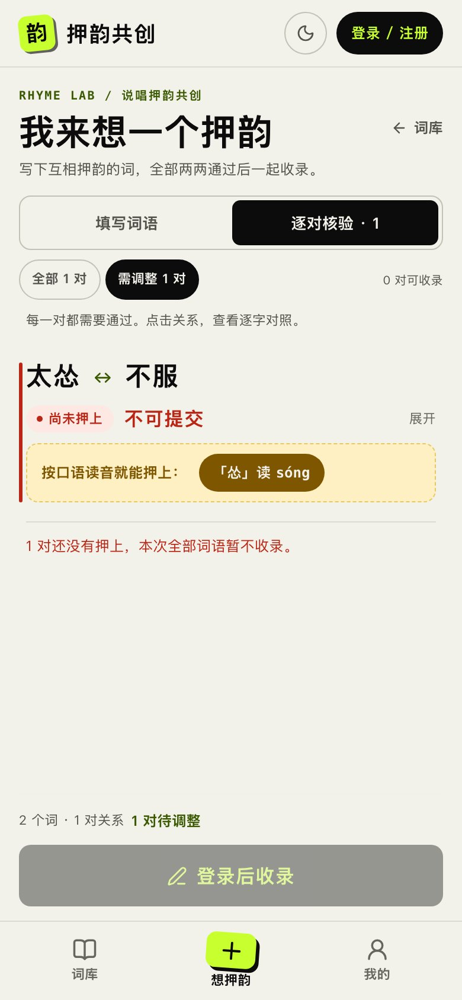
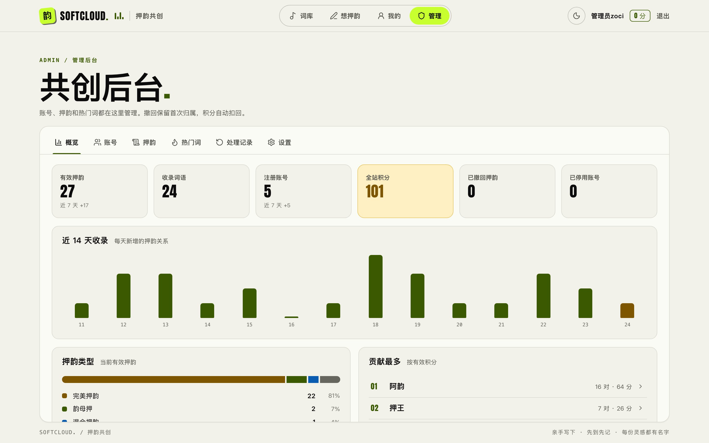
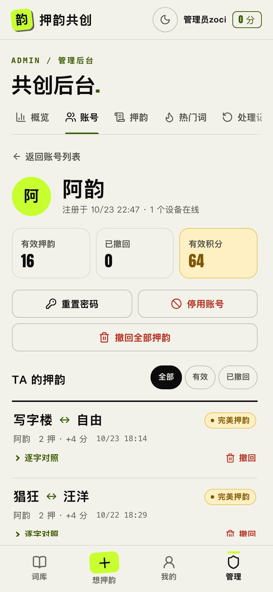
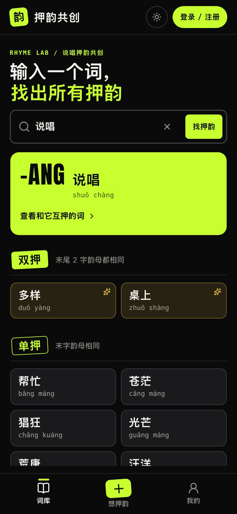
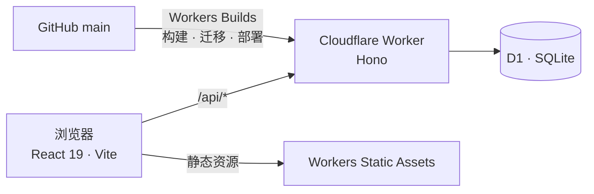

<div align="center">

<a href="https://ya.zoci.pro"></a>

<h3>说唱押韵共创社区 · 写下互相押韵的词，逐字核验，先到先记</h3>

<p>
  <a href="https://ya.zoci.pro"></a>
  
  
  
  
</p>

<p>
  <a href="https://ya.zoci.pro"><b>在线体验</b></a> ·
  <a href="#功能">功能</a> ·
  <a href="#押韵规则">押韵规则</a> ·
  <a href="#本地开发">本地开发</a> ·
  <a href="#部署">部署</a> ·
  <a href="#接口">接口</a>
</p>

</div>

<br>

**押韵共创**是一个为说唱写作准备的押韵词库。用户成组写下互相押韵的词，服务器按普通话韵部和声调**逐字核验**，全部两两押上才收录；每一对押韵关系**永久记录最先提交的人**。词库里的每个词都来自用户，没有导入任何外部押韵表。

<br>

<table>
  <tr>
    <td width="66%"></td>
    <td width="34%"></td>
  </tr>
  <tr>
    <td align="center"><sub><b>找押韵</b> · 按单押 / 双押分区，右侧查看整组互押关系</sub></td>
    <td align="center"><sub><b>想押韵</b> · 逐对核验，一键改用口语读音</sub></td>
  </tr>
</table>

## 功能

- **一个词，找出所有押韵** · 输入任意词，结果按末尾连续押上韵母的字数分区：单押、双押、三押……多押在前，只押声调的放最后。首页附热门词汇。
- **逐字核验** · 一次写 2–50 个词，必须两两押韵才整批收录。每一对都能展开逐字对照，看清哪个字押了韵母、哪个字押了声调。
- **说唱怎么读，就怎么押** · 「怂」字典读 sǒng，大家都读 sóng。常见口语读音作为额外选项提供；差一个读音就能押上时，核验页直接给出一键修正。
- **歌词本** · 在「想押韵」里打开。贴一段歌词，自动标出每行的韵脚和单押 / 双押 / 多押，同一韵脚同一颜色；押上的两行一键带去收录。草稿只存在本机。
- **先到先记** · 规范化后的无向词对全站唯一。第一位成功收录的人永久保留归属和时间，撤回也不会改写。
- **对等互查** · 点开一个词，看到和它直接或间接押韵的整组词，以及支撑这组关系的每一条实际收录。
- **点赞与排行** · 喜欢的押韵可以点赞（一人一赞，不能赞自己，不影响积分），互查页按点赞多少排序；「我的」里有本周 / 上周排行榜。
- **管理后台** · `/admin`：数据概览、账号停用与重置、按人或按词撤回与恢复押韵（积分同步）、屏蔽热门词、暂停投稿，每次操作都有审计记录。
- **手机优先** · 独立的「词库 / 想押韵 / 我的」三屏，长内容各自滚动，主要按钮始终可见；适配 320px 小屏和 iOS Safari 键盘。默认浅色，可切换深色。

<table>
  <tr>
    <td width="66%"></td>
    <td width="34%"></td>
  </tr>
  <tr>
    <td align="center"><sub><b>管理后台</b> · 收录趋势、押韵类型与贡献排行</sub></td>
    <td align="center"><sub><b>账号详情</b> · 重置密码、停用、撤回全部押韵</sub></td>
  </tr>
</table>

<details>
<summary><b>更多截图</b></summary>
<br>
<table>
  <tr>
    <td width="66%"></td>
    <td width="34%"></td>
  </tr>
  <tr>
    <td align="center"><sub>词库首页</sub></td>
    <td align="center"><sub>手机 · 深色模式</sub></td>
  </tr>
</table>
<sub>截图来自本地 <code>wrangler dev</code> 与演示数据。</sub>
</details>

## 押韵规则

两个词按**较短一方的字数 N** 对齐末尾，逐字比较。每个位置至少押上韵母或声调中的一项：

| 种类 | 条件 | 得分 | 例 |
| --- | --- | --- | --- |
| 韵母押 | 每个位置韵母同韵部 | N | 说唱 ↔ 多光 |
| 声调押 | 每个位置声调相同 | N | 山河 ↔ 斑驳 |
| 混合押韵 | 每个位置押韵母或声调之一 | N | 山河天地人 ↔ 风云星底任 |
| **完美押韵** | 韵母与声调全部押上 | **2N** | 光芒 ↔ 苍茫 |

- **读音**：普通话字典读音，不自动变调；多音字可在投稿时选择，选定读音随词对保存。
- **韵部**：允许介音不同 —— `a/ia/ua` · `o/uo` · `ai/uai` · `ei/uei` · `ao/iao` · `ou/iou` · `an/ian/uan/üan` · `en/uen/ün` · `ang/iang/uang` · `eng/ueng` · `ong/iong` · `ie/üe`，其余韵母按自身比较；成音节鼻音保留 `m/n/ng`。
- **口语读音**：精选的「字典没有、大众普遍这样读」的读音，只作为额外选项，默认仍是字典读音。目前包括 怂 sóng、档 dǎng、绕 rǎo、暂 zǎn、质 zhǐ、潜 qiǎn、期 qí、危 / 微 wéi、室 shǐ、塑 suò、酵 xiào、堤 tí、拎 līng、粳 gēng、骰 shǎi、寻 xín（含对应繁体），定义在 [`shared/spoken.ts`](shared/spoken.ts)。不在表里的字不能随意改声调。
- **整批原子**：任一词对未押上、已被收录或已撤回，整批不保存、不计分，输入和读音选择保留。服务器重算分数，`requestId` 保证网络重试不会重复加分。

## 技术架构



| 层 | 选型 |
| --- | --- |
| 前端 | React 19、TypeScript、Vite；单页应用，读音字典（`pinyin-pro`）进入投稿页时才加载 |
| 后端 | Hono on Cloudflare Workers，与静态资源同域部署 |
| 数据 | Cloudflare D1；批量写入在单个事务中完成 |
| 规则 | `shared/` 下的纯 TypeScript，前后端共用同一套押韵判定 |
| 安全 | scrypt 加盐哈希，HttpOnly / SameSite=Lax Cookie，来源校验与分级限流 |
| 设计 | `--sc-*` 设计令牌；Anton 本地打包，不加载外部字体或 CDN；尊重「减少动态效果」 |

<details>
<summary><b>目录结构</b></summary>

```text
src/              React 前端：词库、投稿、歌词本（Lyrics.tsx）、我的、管理后台（AdminConsole.tsx）
worker/           Hono API 与账号认证
shared/           押韵规则：读音、韵部、口语读音、词对比较、搜索分区、歌词分析
migrations/       D1 迁移（0001 – 0004）
tests/            规则单元测试与 API 集成测试
scripts/          初始化、迁移、只读核验脚本
docs/screenshots/ README 截图
```
</details>

## 本地开发

需要 Node.js 22+ 与 pnpm。

```sh
pnpm install --frozen-lockfile
cp .dev.vars.example .dev.vars          # 填入自己生成的 BOOTSTRAP_TOKEN
pnpm exec wrangler d1 migrations apply DB --local
pnpm build                              # 类型检查 + 构建前端（本地不会执行远程迁移）
pnpm worker                             # http://127.0.0.1:8787
pnpm bootstrap http://127.0.0.1:8787    # 一次性建立管理员
```

| 命令 | 内容 |
| --- | --- |
| `pnpm test` | 押韵规则单元测试 |
| `pnpm test:integration` | API 集成测试：自建临时配置、端口与本地 D1，不触碰项目 `.dev.vars` 或线上数据 |
| `pnpm build` | `tsc` + Vite 构建 |

改规则跑 `pnpm test`，改数据库或接口跑 `pnpm test:integration`，发布前跑 `pnpm build`。

## 部署

唯一正式环境：Worker `rhyme-community-ya`，域名 [ya.zoci.pro](https://ya.zoci.pro)，D1 数据库 `rhyme-community`。

- **自动部署**：合并到 `main` 后，Cloudflare Workers Builds 运行 `pnpm run build` 并部署，通常一分钟内上线。
- **数据库迁移**：只有 `main` 分支的构建会对线上 D1 执行待应用迁移；迁移失败则构建失败、不部署。设置 `RHYME_SKIP_REMOTE_MIGRATIONS=1` 可跳过，手动补跑用 `pnpm exec wrangler d1 migrations apply DB --remote`。
- **结构性迁移前**：先在后台「设置」暂停投稿 → 备份并核对 → 迁移 → 发布 → 恢复投稿。不要把测试数据写入线上数据库。
- **部署到自己的账号**：修改 `wrangler.jsonc` 中的账号、Worker 名、数据库 ID 与域名，用 `wrangler secret put BOOTSTRAP_TOKEN` 保存初始化令牌，然后 `npx wrangler deploy`。

<details>
<summary><b>数据迁移记录</b></summary>

| 文件 | 内容 |
| --- | --- |
| `0001_initial.sql` | 账号、会话与早期出题 / 答题表 |
| `0002_mixed_rhyme.sql` | 混合押韵 |
| `0003_direct_pairs.sql` | 词、无向押韵关系、批次与积分明细；早期出题数据按原作者迁移，旧表保留归档 |
| `0004_search_counts.sql` | 热门词计数（只新增表） |
| `0005_pair_likes.sql` | 押韵点赞（只新增表） |

管理后台的停用、恢复、热门词屏蔽与投稿暂停都复用现有表，无需新迁移。点赞是唯一新增的表。
</details>

## 接口

所有写接口要求 JSON、同源请求，并受限流保护；列表每页 30 条。服务器从不接受客户端给出的分数。

<details>
<summary><b>公开与账号接口</b></summary>

| 方法 | 路径 | 说明 |
| --- | --- | --- |
| GET | `/api/health` | 探活 |
| GET | `/api/me` | 当前账号与积分 |
| POST | `/api/auth/register` · `/login` · `/logout` | 注册、登录、退出 |
| GET · POST | `/api/setup` | 一次性管理员初始化 |
| GET | `/api/library/search?q=` | 押韵搜索，按 `tier`（末尾连续押上韵母的字数）分区 |
| GET | `/api/search/hot` | 热门词汇 |
| POST | `/api/search/hits` | 记录一次已确认的搜索 |
| POST | `/api/rhymes/preview` | 预览：读音、逐对结果、重复归属与合计分数 |
| POST | `/api/rhymes` | 收录 `{requestId, items}`，整批原子保存 |
| GET | `/api/rhymes/requests/:requestId` | 确认本人上次提交的结果 |
| GET | `/api/words` · `/api/words/:id/rhymes` · `/api/rhymes/:id` | 词与押韵关系 |
| POST | `/api/rhymes/:id/like` | `{liked}` 点赞或取消，返回最新点赞数 |
| GET | `/api/leaderboard/weekly?week=0\|1` | 本周 / 上周排行（前 10 名 + 自己） |
| GET | `/api/profile` | 我的押韵与积分来源 |

</details>

<details>
<summary><b>管理接口</b>（仅管理员）</summary>

| 方法 | 路径 | 说明 |
| --- | --- | --- |
| GET | `/api/admin/overview` | 概览数字、14 天收录、类型占比、贡献排行 |
| GET | `/api/admin/users` · `/api/admin/users/:id` | 账号列表（搜索 / 筛选）与账号详情 |
| POST | `/api/admin/users/status` | 停用或启用账号，停用即下线 |
| POST | `/api/admin/users/withdraw-all` | 撤回某账号的全部有效押韵 |
| POST | `/api/admin/reset-password` | 重置普通账号密码 |
| GET | `/api/admin/pairs` | 按词语或作者搜索全站押韵 |
| POST | `/api/admin/withdraw` · `/api/admin/restore` | 撤回或恢复一组押韵，积分同步 |
| GET · POST | `/api/admin/hot` | 热门词列表与屏蔽 |
| POST | `/api/admin/settings` | 暂停或恢复投稿 |
| GET | `/api/admin/logs` · `/api/admin/records` | 处理记录 |

</details>

## 更多文档

- [`AGENTS.md`](AGENTS.md) — 内容规则与协作约定
- [`READINESS.md`](READINESS.md) — 上线门槛
- [`VERIFICATION.md`](VERIFICATION.md) — 已验证结果
- [`deployment.json`](deployment.json) · [`wrangler.jsonc`](wrangler.jsonc) — 部署位置与资源 ID

<br>

<div align="center">
<sub><b>softcloud.</b> / 押韵共创 · 亲手写下 · 先到先记 · 每份灵感都有名字</sub>
</div>
