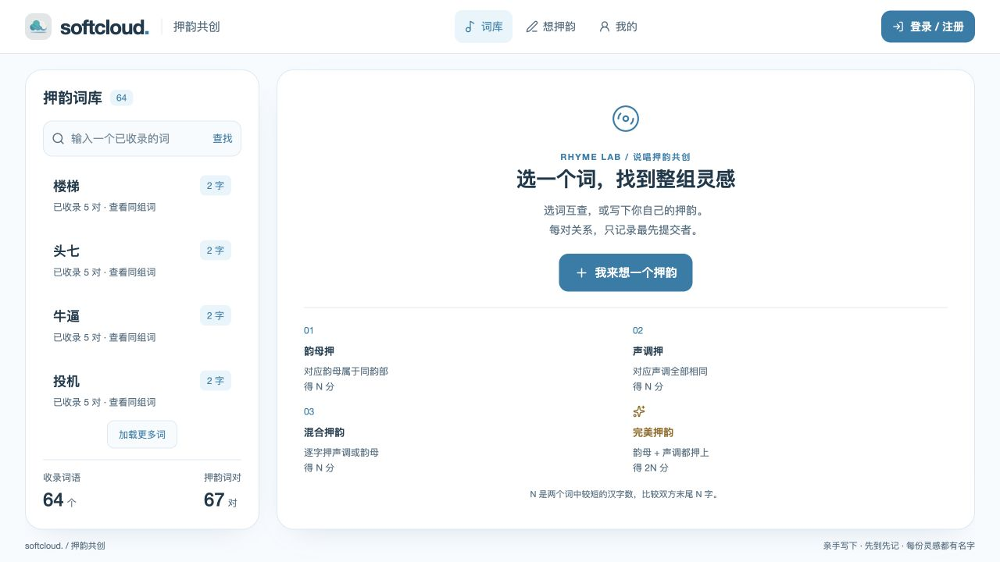

# 押韵共创

使用用户的 `softcloud-design` Skill 构建。React、TypeScript、Vite、Hono、Cloudflare Workers Static Assets 和 D1；正式地址 https://yy.zoci.pro 。正式内容全部来自用户，不导入押韵库或测试种子。

## 投稿与首次归属

主入口是“我来想一个押韵”，不再有先出题、再答题的流程。一次填写 2–50 个词，每词至少两个汉字。词可复用于新的组合，规范化后的无向词对全站唯一，正反顺序和不同读音不会产生第二个名额。

所有词必须两两押韵。每对按较短词的汉字数 N 比较双方末尾 N 字；每个位置的韵部或声调至少匹配一项，可混合。普通有效押韵 N 分，全部韵部与声调都相同为完美押韵 2N 分。每个新词对单独计分，预览显示逐对结果和合计。

任一词对无效、已收录或已撤回，整个批次不保存、不计分，保留输入和读音选择。数据库唯一约束裁定并发抢先，所有内容和积分在同一事务中保存；`requestId` 使网络重试返回原结果而不重复加分。

每条真实押韵关系显示最先成功提交的账号和时间。词本身不归属于某位“出题者”；同组间接成员也不获得虚构的首创记录。首次提交记录表示本站最先收录者。

## 读音与整组互查

保留原文，规范化统一字符宽度并忽略标点、空白和默认不可见字符，包括变体选择符。汉字字数不设固定押韵档位上限，单次请求最多 2 MiB；为限制整批展开成本，所有词合计最多 10,000 个汉字，全部词对按较短词累计的比较位置最多 20,000。超出预算在解析读音前拒绝，输入仍保留；50 个各 15 字的词与两个长句均在预算内。普通话字典读音、不自动变调；多音字可选择合法读音，每个词在一个批次中使用同一套选择，选定读音随词对保存。成音节鼻音保留 `m/n/ng`，空韵母不会产生匹配。

韵母按明确的韵部比较，允许介音不同：`a/ia/ua`、`o/uo`、`ai/uai`、`ei/uei`、`ao/iao`、`ou/iou`、`an/ian/uan/üan`、`en/uen/ün`、`ang/iang/uang`、`eng/ueng`、`ong/iong`、`ie/üe`；其他韵母按自身匹配，不使用字符串包含匹配。逐字对照保留完整韵母和声调，匹配为蓝色、不匹配为红色、完美为金色，并有文字标签。

词库可搜索任意已收录词。有效押韵关系通过共同词构成连通组，任意成员都能查到其余成员。直接投稿过的词对展示首次作者、时间和读音对照；间接成员标为“同组词”，展示支撑它入组的实际收录关系。组内可互查不等于每个间接词对已经通过校验或有人首创。

## 界面、账号与管理

手机底部导航为“词库 / 想押韵 / 我的”。投稿页通过“填写词语 / 逐对核验”切换，长输入、核验和词库在各自区域滚动，提交始终位于可视区。桌面保留双栏。可匿名填写预览，登录后提交，登录和界面切换保留当前草稿；sessionStorage 可用时，同一标签页刷新也保留词语与读音。成功保存的内容和积分由 D1 跨设备同步。

桌面双栏与手机页面都按可视高度布局。个人与管理记录随当前登录账号和页面加载，账号读取期间显示等待状态；返回其他页面后，旧请求不会覆盖新页面或将用户带回旧页面。个人记录的逐字对照展开时才创建内容，收起后释放节点。输入框随文字增高，聚焦时在编辑区内滚动，保持四边可见；输入法组合期间仅显示临时文字，结束时提交一次，取消输入不重置已选读音。读音字典进入投稿页时才加载，加载失败可保留草稿后重试。读音展开时才创建逐字选择项；添加或删除词语后焦点留在编辑区，只改标点及空白时保留已选读音。核验界面每次展示 40 个词对，可继续加载到全部结果；隐藏界面不创建核验卡片，全部词对仍照常校验和计分。核验可筛选“需调整”的词对，并直接回到对应词语修改；查重尚未完成时不能收录。统计分别显示去重的“收录词语”和实际保存的“押韵词对”，同一个词可以参与多对。

已保存与页面刷新分别反馈；积分或词库刷新失败不会将成功投稿说成失败。API 请求包含响应正文读取的 20 秒超时，保存结果超时按未确认处理并允许查询原结果。结果未确认的提交另存原账号、词语、读音与 requestId，刷新后先查询原提交；需要重试时沿用原内容与标识。确认旧提交不会清空后来编辑的新草稿，其他账号无法读取或重放该提交。会话过期时提示重新登录并继续原提交。查词、互查和个人记录分别显示读取、失败与真实空状态，失败可直接重试；新搜索失败时不显示或翻页旧搜索结果，积分来源滚动区可通过键盘聚焦；短视口仍能滚动到多音字选择。

视觉为“Cypher”说唱海报风：默认深色（近黑底 + 荧光酸绿强调色），保留浅色模式（页头切换并保存在本机）。标题与数字使用本地打包的 Anton 窄体（`@fontsource/anton`，仅拉丁字形），中文回退到系统粗黑体；拼音、编号使用等宽字体；颜色、字号、间距、圆角、节拍与动效均为 `--sc-*` 设计令牌。贴纸式徽章（单押/双押/三押、“先到先记”）、荧光划重点与押韵类型跑马灯用于表达说唱气质；EQ 跳动、贴纸轻弹等节拍微动效以 `--sc-beat` 为周期，在“减少动态效果”下全部停止。核验保留蓝色匹配、红色失配和金色完美押韵，均有文字标签。不加载任何外部字体或 CDN。

用户名/密码注册登录，独立随机盐和 scrypt 哈希，Cookie 为 HttpOnly/SameSite=Lax，线上为 Secure。服务器检查来源、限流和管理权限。管理接口无有效会话返回 401，已登录普通账号返回 403；过期会话关闭管理窗口后提示重新登录。管理员通过一次性私有初始化流程建立，普通注册不能成为管理员。退出当前设备不受登录尝试限额耗尽影响，仍保留来源与 JSON 校验；其他设备会话不受该退出影响。注册和管理员初始化将账号、会话及初始化标记在同一事务保存，失败可重试；登录创建会话前重新检查当前密码哈希与禁用状态，防止密码重置或禁用期间建立旧会话。

个人记录为我的押韵关系、累计积分和积分来源。管理员可撤回一条关系、处理普通账号和查看审计记录；撤回保留首次归属与唯一键，取消关联有效积分，并按剩余有效关系更新分组。

## 数据迁移

`0003_direct_pairs.sql` 为增量迁移：新增词、无向关系、批次、积分明细及旧 ID 映射；旧 `topics`、`answers` 保留内部归档。仅实际答案迁移为原题和答案的关系，作者取原答案记录；不补造兄弟答案之间的关系。正反重复历史合并，最早归属不变，展示读音和状态取仍有效来源。

每位用户已有积分逐条保留原得分账号、分数和来源，不因关系合并转给别的用户。没有有效押韵的旧单独题目不进入新词库。旧写接口停止接受内容，只读链接按来源映射兼容。

发布时先测试 staging，然后部署兼容写入暂停版本、设置 `content_write_paused=1`、备份与记录原始数据、迁移和核对、发布新版本，再解除暂停。迁移末尾设置 `pair_model_ready=1`；暂停期间账号和已有内容读取仍可用。切换后回退只使用支持新模型的兼容版本。

## 主要接口

- `GET /api/me`，`POST /api/auth/register|login|logout`，一次性 `POST /api/setup`。
- `POST /api/rhymes/preview` 接收 `{items:[{text,readings?:string[]}]}`，返回读音、逐对结果、重复归属、有效状态及总分。
- `POST /api/rhymes` 接收 `{requestId,items:[{text,readings?:string[]}]}`，返回批次、真实词对、新增积分和重放标志。
- `GET /api/rhymes/requests/:requestId` 仅查询当前账号的原提交，返回 `{found:false}` 或 `{found:true,id,pairs,points,replayed:true,payloadHash}`；写入暂停期间仍可确认结果。
- `GET /api/library` 只读返回按末字韵部（韵脚）分组的词库 `{groups:[{ending,finals,count,pair_count,items}],truncated,counts}`，组内按已收录词对数排序，`tier` 为该词在有效关系中末尾连续押韵母的最大字数（1 单押、2 双押、3 三押…）。`GET /api/library/search?q=` 只读用默认读音与收录规则比对整个词库，返回 `{search:{query,error,exact,rhymes,sameEnding,contains,totals},counts}`；两者不写库、不改表结构。
- `GET /api/words?q=&page=`，`GET /api/words/:id/rhymes?page=`，`GET /api/rhymes/:id`。
- `GET /api/profile?page=` 返回我的关系和积分来源。
- `GET /api/admin/records?page=`，`POST /api/admin/withdraw {type:'pair',id,reason}`，`POST /api/admin/reset-password {id,password}`。

列表每页 30 条。服务器不接受客户端指定分数，失败时返回明确提示。原出题、答题写接口返回改版提示；旧只读接口仅用于兼容。

## 开发与验证

按 `pnpm-lock.yaml` 安装，需要 Node.js 22+ 和 pnpm：

```sh
pnpm install
pnpm test
pnpm test:integration
pnpm build
pnpm worker
```

本地开发在忽略文件 `.dev.vars` 中设置 `BOOTSTRAP_TOKEN`，开发初始化凭证禁止用于线上。集成测试自行生成临时配置、随机空闲端口、本地 D1 和初始化凭证，不依赖项目 `.dev.vars`，并确认健康标识与本轮服务一致；结束自动清理。覆盖历史迁移、整批回滚、并发、幂等、计分、权限、读音、整组互查、撤回、账号重置、完整分页及事务最后一步的故障回滚；另覆盖账号/初始化与会话保存的原子性，以及登录时密码重置、禁用的并发场景。

`verify-pairs-staging.mjs` 仅在独立 staging 生成测试内容，结束后禁用测试账号并保留验证记录。旧版校验脚本仅对应历史验收，不再作为新版验收入口。

`audit-pair-migration.mjs staging|production before|after` 记录及核对历史字段和每位用户积分。实际版本、资源和验证结果见 `deployment.json`、`VERIFICATION.md`、`records/`。数据库备份、兼容构建和私人管理员设置入口放项目外，不进入源码包或公开资产。

`verify-pairs-production-readonly.mjs` 核验正式站历史整组互查、首次归属、旧来源映射与新预览，只读取已收录内容，不向生产保存测试投稿。整批事务的 Cloudflare 契约见 [D1 batch 文档](https://developers.cloudflare.com/d1/worker-api/d1-database/#batch)。

当前上线验收见 `READINESS.md`。`verify-maturity-production-readonly.mjs verify` 使用 Wrangler OAuth 只读核对正式内容字段哈希、逐账号旧积分来源、实际公开归属与历史整组互查，并验证新预览和权限；不调用正式提交接口。基线记录只保存脱敏哈希，不保存用户名、原文、密码或会话。

`node scripts/test-word-input.mjs /absolute/temporary/directory/node_modules/jsdom` 对实际 React DOM 输入组件运行 6 项输入/组合事件回归。官方 jsdom 仅装在项目外临时目录，禁用安装脚本；具体命令见脚本开头，不修改项目依赖和锁文件。该回归验证事件与读音保留，尺寸、裁切和键盘空间另由浏览器验证。

## GitHub 源码与独立部署

完整源码仓库：[zocipro/rhyme-community](https://github.com/zocipro/rhyme-community)。源码 ZIP 见仓库 Releases；依赖通过锁文件安装。源码包含前端、Worker、共享判定、全部数据库迁移、测试、部署配置及脱敏验证记录。

本地启动：

```sh
pnpm install --frozen-lockfile
cp .dev.vars.example .dev.vars
# 在 .dev.vars 中将 BOOTSTRAP_TOKEN 替换为自己生成的随机值
pnpm exec wrangler d1 migrations apply DB --local
pnpm build
pnpm worker
```

随后打开 http://127.0.0.1:8787。新数据库使用一次性管理员初始化；运行 `pnpm bootstrap http://127.0.0.1:8787`，按交互提示填写初始化令牌与管理员用户名，再在生成的私有网页入口设置密码。

独立部署到自己的 Cloudflare 时，在 `wrangler.jsonc` 中换成自己的账号、Worker 名称、生产与 staging 数据库 ID，并配置自己的域名；使用 `wrangler secret put BOOTSTRAP_TOKEN` 保存初始化令牌。先向独立 staging 应用迁移并验证，再发布正式环境。已上线站点升级时保留其 D1 内容，按 README 的迁移核对流程操作。

`.dev.vars`、真实密钥、数据库备份、会话数据及本地运行目录不进入源码仓库或 ZIP。示例配置只有占位值；发布记录中的 Cloudflare 账号/数据库/版本 ID 用于定位构建，不是认证凭证。

界面预览：




